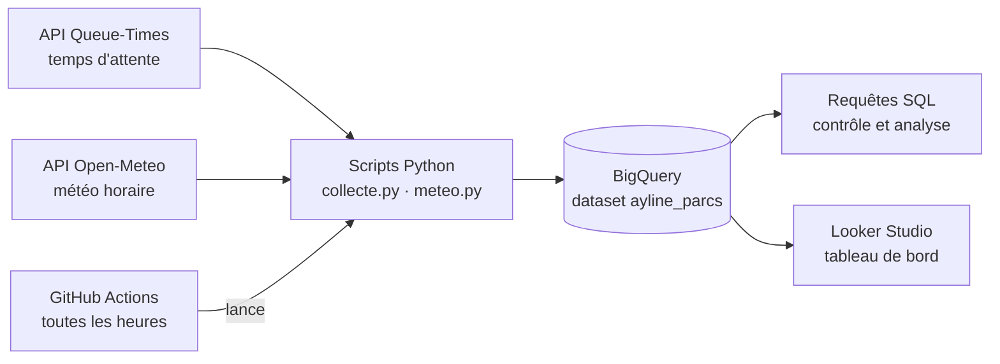

# Ayline Parcs : de l'API au tableau de bord

Pipeline de données qui collecte chaque heure les temps d'attente de parcs d'attractions français et la météo, les stocke dans BigQuery et les restitue dans un tableau de bord Looker Studio.

Projet individuel réalisé par **Zohair** dans le cadre de la formation Data Analyst de Simplon Lyon (octobre 2026).

## Livrables

| Livrable | Lien |
|---|---|
| Tableau de bord Looker Studio (en ligne) | [Ouvrir le tableau de bord](LIEN_LOOKER_STUDIO) |
| Tableau de bord (export PDF) | [docs/dashboard_Ayline_Parcs.pdf](docs/dashboard_Ayline_Parcs.pdf) |
| Présentation orale | [docs/Presentation_parcsAyline_Zohair.pdf](docs/Presentation_parcsAyline_Zohair.pdf) |

## Le besoin

Ayline Parcs veut savoir :
1. quels jours et quelles heures recommander à ses clients pour chaque parc ;
2. si la météo influence l'affluence.

Le nombre de visiteurs n'étant pas disponible, le **temps d'attente des attractions** sert d'indicateur indirect de l'affluence.

## Architecture



- **Queue-Times** fournit, pour chaque parc, la liste des attractions, leur statut (ouverte ou fermée) et leur temps d'attente.
- **Open-Meteo** fournit la météo heure par heure à partir des coordonnées de chaque parc.
- **GitHub Actions** exécute les deux scripts toutes les heures, même quand l'ordinateur est éteint.
- **BigQuery** (mode bac à sable, gratuit) stocke les données.
- **Looker Studio** lit BigQuery pour afficher le tableau de bord.

## Structure du dépôt

```
.
├── .github/workflows/collecte.yml   # automatisation horaire (GitHub Actions)
├── src/
│   ├── collecte.py                  # temps d'attente : API Queue-Times → BigQuery
│   └── meteo.py                     # météo : API Open-Meteo → BigQuery
├── sql/                             # requêtes de contrôle et d'analyse, numérotées
├── docs/                            # présentation et tableau de bord (PDF)
├── notebooks/
│   ├── 01_exploration_api.ipynb     # découverte de l'API Queue-Times
│   └── 02_exploration_meteo.ipynb   # découverte de l'API Open-Meteo
└── requirements.txt
```

## Parcs suivis

| id Queue-Times | Parc |
|---|---|
| 4 | Disneyland Park Paris |
| 28 | Disney Adventure World Paris |
| 9 | Parc Astérix |
| 291 | Futuroscope |
| 301 | Walibi Rhône-Alpes |
| 303 | Le Pal |
| 336 | Nigloland |
| 304 | Vulcania |
| 327 | Le Parc du Petit Prince |
| 320 | PanoraMagique |

## Les tables BigQuery

Projet `ayline-parcs`, dataset `ayline_parcs` (région EU). Une table par sujet, reliées par l'identifiant du parc et l'heure.

| Table | Contenu | Rempli par |
|---|---|---|
| `temps_attente` | une ligne par attraction et par mise à jour de l'API : statut, attente en minutes, file Single Rider | `collecte.py` |
| `meteo_horaire` | une ligne par parc et par heure : température, précipitations, vent, libellé du temps | `meteo.py` |
| `parcs` | la liste des parcs français et leurs coordonnées | `meteo.py` |
| `logs_collecte` | une ligne par exécution : statut, lignes collectées, doublons ignorés, lignes insérées | `collecte.py` |
| `logs_meteo` | même chose pour la météo | `meteo.py` |

**Protection contre les doublons** : une mesure est identifiée par `id_parc` + `id_attraction` + `date_maj_api`. Si elle existe déjà dans la table (l'API n'a pas été rafraîchie entre deux collectes), elle n'est pas réinsérée et elle est comptée dans `nb_doublons_ignores`. La météo suit la même règle avec `id_parc` + `heure_utc`.

## Automatisation

Le fichier `.github/workflows/collecte.yml` lance la collecte toutes les heures à la minute 7 (heure UTC), et permet aussi un lancement manuel depuis l'onglet **Actions** (`workflow_dispatch`).

La clé du compte de service Google est stockée dans le secret GitHub `GCP_CLE_JSON` : elle n'apparaît jamais dans le code.

## Lancer le projet en local

```bash
git clone https://github.com/Zohair69/parcs-attractions-pipeline.git
cd parcs-attractions-pipeline
python -m venv .venv
source .venv/Scripts/activate      # Windows (Git Bash) ; sous Linux/Mac : source .venv/bin/activate
pip install -r requirements.txt
```

Placer la clé du compte de service BigQuery dans `~/cles_gcp/cle_bigquery.json` (en dehors du projet, pour ne jamais la publier), puis :

```bash
python src/collecte.py
python src/meteo.py
```

## Les requêtes SQL

Chaque chiffre affiché dans le tableau de bord est recalculé ou vérifié par une requête du dossier `sql/`.

| Requête | Rôle |
|---|---|
| `00_controle_doublons` | vérifier qu'aucune mesure n'est en double |
| `01_traces_execution` | lire les logs de collecte |
| `02_controle_attentes` | vérifier que chaque parc transmet des temps d'attente |
| `03_analyse_par_parc` | attente moyenne et taux d'ouverture par parc |
| `04_analyse_par_heure` | attente moyenne par heure (heure de Paris), parcs Disney |
| `05_analyse_meteo` | attente selon le type de temps (jointure attente × météo) |
| `06_controle_weekend` | taux d'ouverture par jour de la semaine, parcs hors Disney |
| `07_executions_par_jour` | nombre d'exécutions réussies par jour |
| `08_controle_kpi_dashboard` | recalculer les indicateurs de Looker et vérifier que la jointure météo ne duplique aucune ligne |
| `09_parc_sans_donnees` | repérer les parcs sans aucune mesure (Vulcania) |
| `10_fiabilite_statut_ouvert` | tester la fiabilité du statut « ouvert » selon les parcs |
| `11_taux_ouverture_disney` | taux d'ouverture des parcs Disney |
| `12_attente_par_heure_disney` | attente et nombre de jours observés par heure |
| `13_taux_ouverture_hors_minuit` | taux d'ouverture sans les relevés de minuit |
| `14_meteo_nb_heures_disney` | nombre d'heures observées par type de temps |
| `15_heures_avec_pluie_disney` | heures de pluie pendant l'ouverture des parcs |

## Le tableau de bord

Cinq pages dans Looker Studio, avec un filtre Parc commun à toutes les pages ([version en ligne](LIEN_LOOKER_STUDIO), [export PDF](docs/dashboard_Ayline_Parcs.pdf)) :
1. **Vue d'ensemble** : indicateurs clés et attente moyenne par parc ;
2. **Attente selon l'heure** : attente heure par heure pour chaque parc Disney ;
3. **Effet de la météo** : attente selon le type de temps ;
4. **Recommandations** : quand venir dans chaque parc ;
5. **Limites** : ce qui reste à confirmer.

Charte : police Lato, couleurs `#4A6C8C`, `#D4A373`, `#9DB4C8`, `#8C7A6B`.

## Limites

- Le temps d'attente est un indicateur **indirect** de l'affluence.
- Vulcania est référencé par Queue-Times, mais l'API ne renvoie aucune attraction.
- Le statut « ouvert » n'est fiable que pour les parcs Disney : les analyses d'attente portent sur ces deux parcs.
- GitHub Actions ne garantit pas l'horaire des tâches programmées : la collecte compte moins de 24 exécutions par jour.
- La collecte a démarré le 12 octobre 2026 : le recul est encore court.

## Crédits

- Données : [Queue-Times](https://queue-times.com) (Powered by Queue-Times.com) et [Open-Meteo](https://open-meteo.com).
- Pictogramme : Google Material Symbols (licence Apache 2.0).

Auteur : Zohair, Simplon Lyon.
